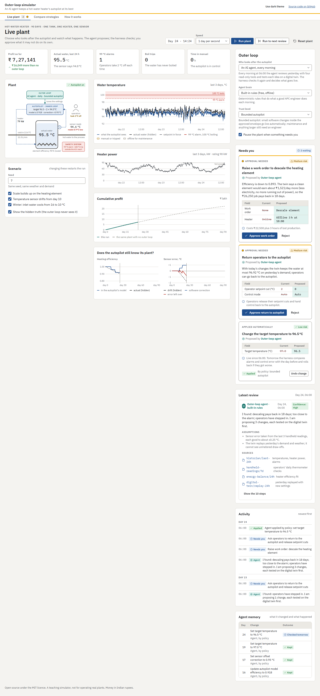
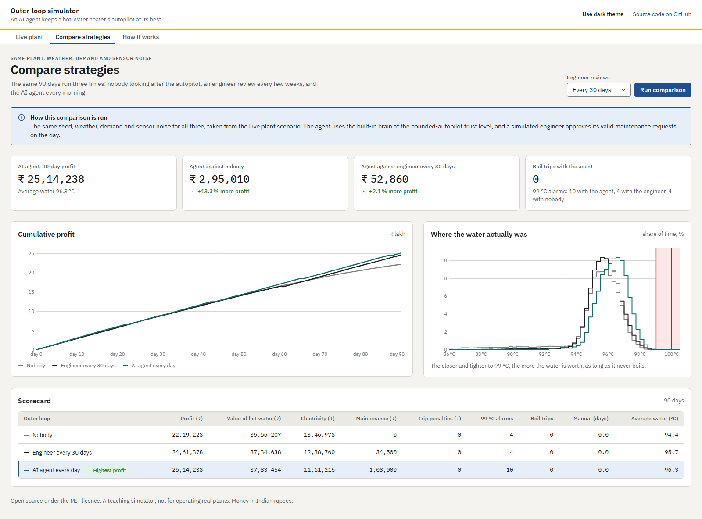
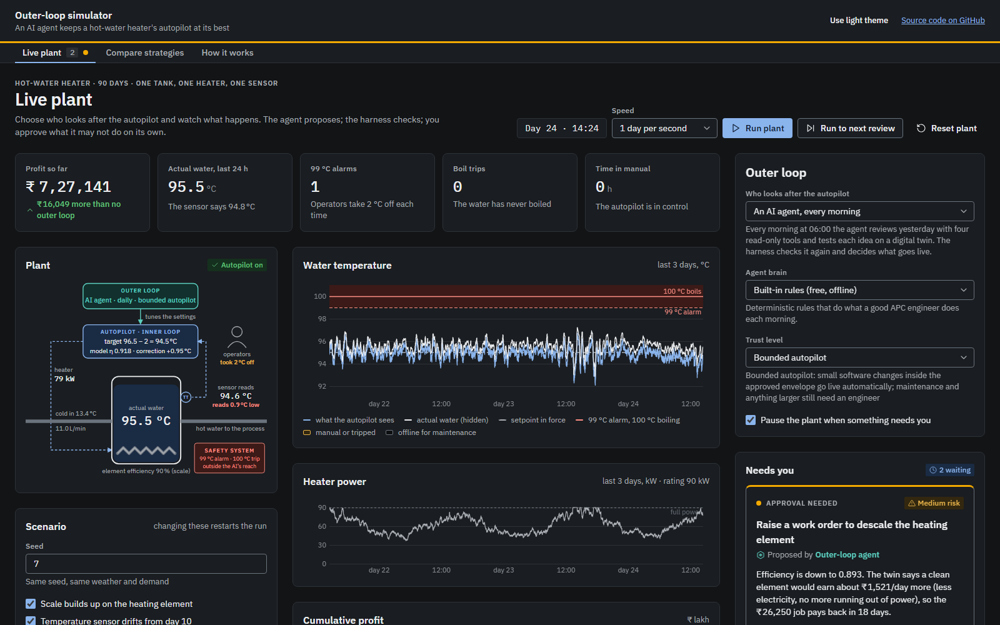

# Outer-Loop Simulator

**An AI agent that keeps a plant's autopilot at its best, and the harness that keeps the agent safe.**

Process plants already run an *inner loop*: advanced process control (the "autopilot") holds the process at its targets every minute. But the autopilot is only as good as its model, its sensors and its targets, and all three go stale. Equipment fouls, instruments drift, seasons change, and operators lose trust and switch it off. Keeping the autopilot at its best is an *outer loop* that today runs on people: an engineer who finds the time every few weeks or months.

This simulator shows what happens when an **LLM agent inside a harness** runs that outer loop every day. The process is deliberately simple, a hot-water heater that must never boil, so the ideas are easy to see.



## Run it

You need [Node.js](https://nodejs.org) 20 or later. There are no dependencies and no build step.

```bash
git clone <this repo>
cd outer-loop-simulator
npm start            # then open http://localhost:5173
```

Other commands:

```bash
npm test             # simulator, harness and Claude-brain tests (node:test)
npm run compare      # the three-strategy scorecard in the terminal: npm run compare -- <seed> <days> <engineer interval>
```

Because it is a static site, it also runs on GitHub Pages: *Settings → Pages → Deploy from a branch → main / (root)*.

## What you can do

- **Live plant.** Watch the heater minute by minute: the water temperature the autopilot sees, the hidden truth, the heater power, the profit, and whether the autopilot's picture of the plant (its model and its sensor) is still right. Choose who looks after the autopilot: nobody, an engineer every few weeks, or an AI agent every morning. Set the agent's trust level, approve or reject what it asks for, and read every tool call it made.
- **Compare strategies.** The same 90 days, weather, demand and sensor noise, run three times: no outer loop, an engineer review every *N* days, and the agent.
- **How it works.** The plant, the failure modes and the harness explained.

## The plant

A 300 kg tank is fed with cold water and heated by a 90 kW element. Hot water goes to a downstream process that pays more the hotter it is, so the profitable place to run is just below boiling.

```
M·cp·dT/dt = F·cp·(Tin − T) + η·Q − UA·(T − Tamb)
```

- **Inner loop:** a model-based controller (feedforward plus a PI loop tuned by IMC rules from its internal model). It runs every minute.
- **Safety:** an independent switch raises an alarm at 99 °C, and a safety system cuts the heater at 100 °C. Neither is reachable by the agent.
- **What goes wrong:** scale on the element lowers the heating efficiency η, so the model goes stale. The temperature sensor drifts and reads low, so the water is hotter than the controller thinks. Winter brings colder inlet water.
- **People:** after a high-temperature alarm, operators knock 2 °C off the setpoint. After three alarms in a day, or a boil trip, they switch the autopilot to manual.

## The agent harness

The agent's *brain* only reasons and proposes. Everything that keeps it safe is ordinary code around it, in [`src/agent/harness.js`](src/agent/harness.js):

| Harness piece | In this simulator |
|---|---|
| **Tools** | Read-only: daily report from the historian, sensor check against operators' handheld readings, model re-identification from an energy balance, digital-twin backtest ([`tools.js`](src/agent/tools.js), [`twin.js`](src/agent/twin.js)). No tool can touch the safety system. |
| **Guardrails** | An approved envelope: target 85–97 °C, model efficiency 0.5–1.05, sensor correction ±3 °C, plus a maximum change per day. |
| **Independent check** | The harness re-runs yesterday on its own twin with the proposed settings and blocks anything that raises the boiling risk, whatever the brain claimed. |
| **Trust ladder** | *Advisor*: recommends only. *Co-pilot*: an engineer approves each change. *Bounded autopilot*: small software changes inside the envelope go live on their own; maintenance and larger steps still need a person. |
| **Monitoring and rollback** | The next morning the harness compares the day after an automatic change with the day before. If there are more alarms, a trip, or much worse control, it puts the old settings back. |
| **Audit trail and memory** | Every tool call, decision and change is logged. The brain is told what it changed recently and what happened next. |

Two brains plug into the same harness:

- **Built-in rules** ([`rule-brain.js`](src/agent/rule-brain.js)): what a good APC engineer does each morning, done deterministically. It is free and works offline.
- **Claude** ([`claude-brain.js`](src/agent/claude-brain.js)): gets the same tools and a description of the plant, and decides for itself what to check and what to propose. It goes through exactly the same guardrails, twin check and approvals.

## Results

Ninety days, default scenario (scale, sensor drift, winter). The agent uses the built-in brain at bounded-autopilot trust, with a simulated engineer approving its maintenance requests on the day:

| Seed | No outer loop | Engineer every 30 days | AI agent every day |
|---|--:|--:|--:|
| 7 | ₹ 22,19,228 | ₹ 24,61,378 | ₹ 25,14,238 |
| 11 | ₹ 22,25,175 | ₹ 24,36,593 | ₹ 25,01,579 |
| 23 | ₹ 22,26,375 | ₹ 24,58,921 | ₹ 25,05,752 |
| 42 | ₹ 22,20,466 | ₹ 24,22,656 | ₹ 25,13,869 |
| 101 | ₹ 22,13,411 | ₹ 24,30,270 | ₹ 25,42,074 |



The agent earns about 13% more than no outer loop and 2–5% more than a monthly engineer review, with no boil trips. It does trigger more 99 °C alarms (7–10 against 2–4), because it runs closer to the limit. The simulated engineer is deliberately generous: a perfect step test, the sensor recalibrated, and the element descaled at every visit. In real plants the gap between "every few months" and "every day" is usually wider.

## Using Claude as the brain

Select **Claude (your API key)** under *Agent brain* and paste an [Anthropic API key](https://console.anthropic.com/).

- **Models:** Claude Opus 5.5 (default), Sonnet 5.5 or Haiku 5.5.
- **Each daily review** is one short agent run of about 5–8 API calls. Claude calls the tools and finishes with `submit_proposals`, giving a summary, its confidence and its assumptions; the harness then checks and routes each proposal.
- **Server-side fallbacks are switched on for Opus and Sonnet.** If a request is declined, Anthropic retries it on a suitable model. Haiku runs without fallbacks.
- **Your key** stays in the browser tab (it is never saved) and is sent only to `api.anthropic.com`, using the official SDK in browser mode. That is fine for running locally with your own key, but don't paste a key into a copy hosted by someone else. For a real deployment, put a small server between the browser and the API.
- **Cost:** a full 90-day run is roughly 90 short agent conversations. Use Haiku or the built-in brain for long runs.

## Project layout

```
index.html, styles.css      the app (no build step)
src/sim/                    plant physics, autopilot, operators, economics, historian
src/agent/                  tools, digital twin, harness, built-in brain, Claude brain
src/strategies.js           no outer loop / engineer review / agent, and batch runs
src/ui/                     live view, charts, plant diagram
src/ui/rb.js                the design-system components as plain DOM builders
src/ui/rohan/               design tokens and component styles (copied unchanged)
scripts/                    static server, terminal scorecard, README screenshots
tests/                      node:test suites
```

## Design

The interface follows the **Rohan Builders design system**. Its tokens (`tokens.css`) and component styles (`rohan.css`) are in [`src/ui/rohan/`](src/ui/rohan/), copied unchanged. The components themselves (approval cards, the agent's timeline and message, stats, tables, badges) are re-implemented in plain JavaScript in [`src/ui/rb.js`](src/ui/rb.js), with the same markup and class names as the system's React bundle. Light and dark themes are both supported, and money is shown in Indian rupees.

Following the system's agent model, the agent's work shows as a timeline of steps, its answer comes with confidence, assumptions and sources, and every change it cannot make on its own waits in an approval card. Changes made automatically under the bounded-autopilot policy show as "Applied automatically", with an Undo button.



## Limits

This is a teaching model, not a design tool. The physics is a single well-mixed tank, the economics are illustrative, and the numbers are realistic in shape but not calibrated to any real plant. Nothing here is fit to run real equipment.

## Ideas for contributions

- A second unit (for example a heat exchanger that fouls) and more failure modes, such as a sticking valve or a step change in feed.
- Other brains (other LLMs, or a classical optimiser) behind the same harness.
- A small backend so that Claude mode can run without a key in the browser.

## License

[MIT](LICENSE)
